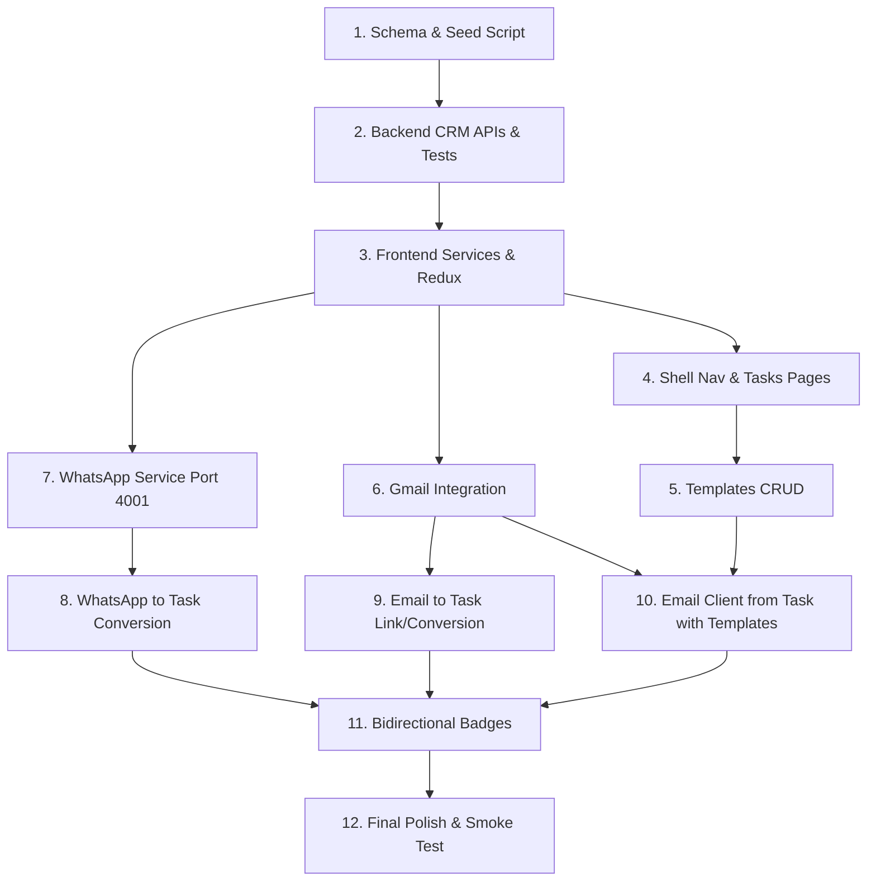

# Migration Plan: Unified Inbox & CRM into Turia Agent Center

**Date:** 2026-10-13  
**Status:** Approved Architectural Plan (Ready for Execution)  
**Target Codebase:** Turia Agent Center (`frontend/` + `backend/` + `whatsapp-server/`)  
**Reference Codebase:** `_reference/unified-inbox/` (Read-only reference)

---

## 1. Executive Summary & Architectural Overview

This document specifies the complete, non-breaking port of Unified Inbox and CRM capabilities from `_reference/unified-inbox/` into the Turia Agent Center.

### Core Architecture & Isolation Principles:
1. **Zero Impact on Existing Agent Center**:
   - The existing Agent Center UI (`/agent-center`, `/agents/*`, `/history`), Redux state (`state.agents`), Express routes (`/api/agents`, `/api/history`, `/api/agent-definitions`), SQLite schema (`agents`, `agent_runs`), and automated tests (165 passing tests) remain 100% untouched and functional.
2. **Unified Express + SQLite Backend**:
   - All CRM data persistence is consolidated into the existing Express + SQLite backend on port 4000.
   - SQLite tables (`team_members`, `clients`, `tasks`, `task_links`, `email_templates`, `task_emails`, `chat_statuses`) adhere to the strict conventions of `backend/src/db/schema.sql` (ISO-8601 UTC timestamps, `CHECK` constraints, foreign keys with `ON DELETE CASCADE`, indexed queries, no ORMs).
   - Seed data is isolated to `npm run seed` and is never executed during normal schema initialization (preserving clean tests).
3. **Frontend Hybrid Architecture**:
   - Next.js 15 App Router (`frontend/`) hosts both client pages (`/tasks`, `/tasks/[id]`, `/templates`, `/connections`, `/whatsapp`, `/email`) and Gmail OAuth / API route handlers (`/api/auth/google/*`, `/api/gmail/*`).
   - All CRM data queries route to the Express backend via `frontend/src/services/crmApi.js` and dedicated Redux Toolkit slices (`tasks`, `templates`, `connections`, `whatsapp`, `email`).
4. **Isolated WhatsApp Microservice on Port 4001**:
   - The `whatsapp-web.js` + `socket.io` service is placed in `whatsapp-server/` running on port 4001 (`PORT=4001`).
   - The WhatsApp server remains entirely stateless and decoupled from the database. All persistence (chat status, message-to-task conversions) routes strictly through the frontend to the Express backend.

---

## 2. File-by-File Mapping Table (`_reference/` → This Repo)

| Reference Path (`_reference/unified-inbox/`) | Destination Path in This Repo | Action / Reason |
|---|---|---|
| **SERVER (`server/`)** | | |
| `server/.env.example` | `whatsapp-server/.env.example` | Ported: configures `PORT=4001`, `WEB_ORIGIN=http://localhost:3000`. |
| `server/.gitignore` | `whatsapp-server/.gitignore` | Ported: ignores `.wwebjs_auth/`, `.wwebjs_cache/`, `node_modules/`. |
| `server/index.js` | `whatsapp-server/index.js` | Ported: updated default `PORT` to 4001 and CORS origin to `http://localhost:3000`. |
| `server/package.json` | `whatsapp-server/package.json` | Ported: maintains Express, socket.io, whatsapp-web.js dependencies. |
| `server/package-lock.json` | `whatsapp-server/package-lock.json` | Ported: clean lockfile for WhatsApp server. |
| `server/waClient.js` | `whatsapp-server/waClient.js` | Ported directly: client initialization, QR generation, Socket.IO bridge. |
| **WEB API ROUTES (`web/app/api/`)** | | |
| `web/app/api/auth/google/route.js` | `frontend/src/app/api/auth/google/route.js` | Ported: Next.js 15 Route Handler for Google OAuth redirect. |
| `web/app/api/auth/google/callback/route.js` | `frontend/src/app/api/auth/google/callback/route.js` | Ported: Next.js 15 adapted (async `await cookies()`). |
| `web/app/api/auth/logout/route.js` | `frontend/src/app/api/auth/logout/route.js` | Ported: Next.js 15 adapted (async `await cookies()`). |
| `web/app/api/gmail/profile/route.js` | `frontend/src/app/api/gmail/profile/route.js` | Ported: Next.js 15 Route Handler reading sealed session cookie. |
| `web/app/api/gmail/send/route.js` | `frontend/src/app/api/gmail/send/route.js` | Ported: Next.js 15 Route Handler sending emails via Gmail API. |
| `web/app/api/gmail/threads/route.js` | `frontend/src/app/api/gmail/threads/route.js` | Ported: Next.js 15 Route Handler listing threads. |
| `web/app/api/gmail/threads/[id]/route.js` | `frontend/src/app/api/gmail/threads/[id]/route.js` | Ported: Next.js 15 adapted (async `const { id } = await params`). |
| `web/app/api/chats/linked-tasks/route.js` | `backend/src/routes/tasks.js` (`GET /api/tasks/links/by-chat`) | Ported to Express backend: query SQLite `task_links` table. |
| `web/app/api/chats/status/route.js` | `backend/src/routes/chats.js` (`GET`, `PATCH /api/chats/status`) | Ported to Express backend: query/upsert SQLite `chat_statuses` table. |
| `web/app/api/clients/route.js` | `backend/src/routes/clients.js` (`GET`, `POST /api/clients`) | Ported to Express backend: replaces Prisma with SQLite. |
| `web/app/api/clients/match/route.js` | `backend/src/routes/clients.js` (`GET /api/clients/match`) | Ported to Express backend: match client by phone/email in SQLite. |
| `web/app/api/email/linked-tasks/route.js` | `backend/src/routes/tasks.js` (`GET /api/tasks/links/by-thread`) | Ported to Express backend: query SQLite `task_links` table. |
| `web/app/api/tasks/route.js` | `backend/src/routes/tasks.js` (`GET`, `POST /api/tasks`) | Ported to Express backend: task CRUD with pagination & filtering. |
| `web/app/api/tasks/[id]/route.js` | `backend/src/routes/tasks.js` (`GET`, `PATCH`, `DELETE /api/tasks/:id`) | Ported to Express backend: task detail, status update, deletion. |
| `web/app/api/tasks/[id]/email/route.js` | `backend/src/routes/tasks.js` (`POST /api/tasks/:id/emails`) | Replaced: 2-step client orchestration (Next Gmail send -> Express record). |
| `web/app/api/tasks/[id]/links/route.js` | `backend/src/routes/tasks.js` (`POST /api/tasks/:id/links`) | Ported to Express backend: create WhatsApp or Email reference link. |
| `web/app/api/tasks/[id]/links/[linkId]/route.js` | `backend/src/routes/tasks.js` (`DELETE /api/tasks/:id/links/:linkId`) | Ported to Express backend: delete task link. |
| `web/app/api/team/route.js` | `backend/src/routes/team.js` (`GET /api/team`) | Ported to Express backend: list seeded team members. |
| `web/app/api/templates/route.js` | `backend/src/routes/templates.js` (`GET`, `POST /api/templates`) | Ported to Express backend: list and create email templates. |
| `web/app/api/templates/[id]/route.js` | `backend/src/routes/templates.js` (`PATCH`, `DELETE /api/templates/:id`) | Ported to Express backend: update and delete template. |
| `web/app/api/test-db/route.js` | *Not ported* | Redundant: Prisma health check. Existing `GET /api/health` validates SQLite. |
| **WEB PAGES (`web/app/`)** | | |
| `web/app/connections/page.js` | `frontend/src/app/connections/page.jsx` | Ported: accounts connection status page (Gmail & WhatsApp). |
| `web/app/whatsapp/page.js` | `frontend/src/app/whatsapp/page.jsx` | Ported: WhatsApp inbox interface. |
| `web/app/email/page.js` | `frontend/src/app/email/page.jsx` | Ported: Gmail inbox & thread viewer interface. |
| `web/app/tasks/page.js` | `frontend/src/app/tasks/page.jsx` | Ported: CRM Task dashboard with status/priority filtering. |
| `web/app/tasks/layout.js` | *Not ported* | Shell layout is already globally provided by `frontend/src/components/AppLayout.jsx`. |
| `web/app/tasks/[id]/page.js` | `frontend/src/app/tasks/[id]/page.jsx` | Ported: Task detail view with linked communication timeline (Next 15 `await params`). |
| `web/app/templates/page.js` | `frontend/src/app/templates/page.jsx` | Ported: Email templates CRUD management view. |
| `web/app/templates/layout.js` | *Not ported* | Shell layout handled by `AppLayout.jsx`. |
| `web/app/layout.js` | *Not ported* | Existing `frontend/src/app/layout.jsx` is preserved. |
| `web/app/page.js` | *Not ported* | Existing redirect to `/agent-center` is preserved. |
| `web/app/providers.js` | `frontend/src/store/Providers.jsx` (merged) | Ported logic: WhatsApp socket listener & toast context merged into existing Provider. |
| `web/app/globals.css` | `frontend/src/app/globals.css` (appended) | Ported utilities: append CRM-specific styles (e.g. badge colors) without overwriting Turia classes. |
| `web/app/favicon.ico` | *Not ported* | Preserved existing Turia brand favicon. |
| `web/app/fonts/*` | *Not ported* | Preserved existing font setup. |
| **WEB COMPONENTS (`web/components/`)** | | |
| `web/components/Avatar.js` | `frontend/src/components/crm/Avatar.jsx` | Ported: user/client avatar initials badge. |
| `web/components/StatusPill.js` | `frontend/src/components/crm/StatusPill.jsx` | Ported: task and chat status badges. |
| `web/components/Toast.js` | `frontend/src/components/crm/Toast.jsx` | Ported: notification alerts for action feedback. |
| `web/components/TopNav.js` | *Not ported* | Preserved existing `AppHeader.jsx` & `AppSidebar.jsx`. Shell nav links updated. |
| `web/components/connections/GmailCard.js` | `frontend/src/components/connections/GmailCard.jsx` | Ported: OAuth connection status card with connect/disconnect. |
| `web/components/connections/WhatsAppCard.js` | `frontend/src/components/connections/WhatsAppCard.jsx` | Ported: QR code and socket connection status card. |
| `web/components/email/ComposeModal.js` | `frontend/src/components/email/ComposeModal.jsx` | Ported: standalone Gmail composer modal. |
| `web/components/email/ThreadList.js` | `frontend/src/components/email/ThreadList.jsx` | Ported: email list with "Linked to TSKxxxx" badge. |
| `web/components/email/ThreadView.js` | `frontend/src/components/email/ThreadView.jsx` | Ported: email thread view with "Convert to Task" & "Link to Task" actions. |
| `web/components/tasks/ConvertEmailToTaskModal.js` | `frontend/src/components/tasks/ConvertEmailToTaskModal.jsx` | Ported: prefilled email-to-task modal. |
| `web/components/tasks/ConvertToTaskModal.js` | `frontend/src/components/tasks/ConvertToTaskModal.jsx` | Ported: prefilled WhatsApp message-to-task modal. |
| `web/components/tasks/CreateTaskModal.js` | `frontend/src/components/tasks/CreateTaskModal.jsx` | Ported: generic manual task creation modal. |
| `web/components/tasks/LinkToTaskModal.js` | `frontend/src/components/tasks/LinkToTaskModal.jsx` | Ported: link email or WhatsApp message to an existing task. |
| `web/components/tasks/LinkedCommsTimeline.js` | `frontend/src/components/tasks/LinkedCommsTimeline.jsx` | Ported: chronological linked WhatsApp/Email communications list. |
| `web/components/tasks/TaskCard.js` | `frontend/src/components/tasks/TaskCard.jsx` | Ported: card view for task items. |
| `web/components/tasks/TaskCodeBadge.js` | `frontend/src/components/tasks/TaskCodeBadge.jsx` | Ported: clickable `TSK0042` badge linking to `/tasks/:id`. |
| `web/components/tasks/TaskEmailModal.js` | `frontend/src/components/tasks/TaskEmailModal.jsx` | Ported: Send email to client modal with template dropdown and variable substitution. |
| `web/components/tasks/TaskFilters.js` | `frontend/src/components/tasks/TaskFilters.jsx` | Ported: dashboard filters (status, assignee, client, search). |
| `web/components/tasks/TaskInfo.js` | `frontend/src/components/tasks/TaskInfo.jsx` | Ported: editable task metadata sidebar (status, priority, due date). |
| `web/components/tasks/TaskPagination.js` | `frontend/src/components/tasks/TaskPagination.jsx` | Ported: task list pagination controls. |
| `web/components/whatsapp/ChatList.js` | `frontend/src/components/whatsapp/ChatList.jsx` | Ported: chat list with status tabs (All / Open / Resolved). |
| `web/components/whatsapp/ChatThread.js` | `frontend/src/components/whatsapp/ChatThread.jsx` | Ported: WhatsApp chat view with message action dropdown. |
| `web/components/whatsapp/Composer.js` | `frontend/src/components/whatsapp/Composer.jsx` | Ported: WhatsApp text composer. |
| `web/components/whatsapp/MessageBubble.js` | `frontend/src/components/whatsapp/MessageBubble.jsx` | Ported: message bubble with "Convert to Task" context menu & task badge. |
| `web/components/whatsapp/TaskDrawer.js` | *Not ported (Retired)* | Retired: replaced by navigation to `/tasks` and dedicated CRM modals. |
| **WEB LIBRARIES & STORE (`web/lib/`)** | | |
| `web/lib/db.js` | *Not ported* | Prisma singleton. All database access is in Express `backend/src/db/`. |
| `web/lib/gmailParse.js` | `frontend/src/lib/gmailParse.js` | Ported: extracts sender, subject, date, body snippet from Gmail API. |
| `web/lib/google.js` | `frontend/src/lib/google.js` | Ported: Google OAuth2 client, iron-session v8 integration (async `cookies()`). |
| `web/lib/mime.js` | `frontend/src/lib/mime.js` | Ported: RFC 2822 email payload builder for Gmail send API. |
| `web/lib/normalise.js` | `frontend/src/lib/normalise.js` | Ported: phone E.164 normalization & email address extraction. |
| `web/lib/socket.js` | `frontend/src/lib/socket.js` | Ported: singleton socket client pointing to `http://localhost:4001`. |
| `web/lib/store.js` | `frontend/src/store/store.js` (merged) | Merged: new reducers registered in existing Redux store. |
| `web/lib/slices/connectionsSlice.js` | `frontend/src/store/connectionsSlice.js` | Ported: tracks Gmail and WhatsApp connection statuses. |
| `web/lib/slices/emailSlice.js` | `frontend/src/store/emailSlice.js` | Ported: threads, messages, active thread, compose state. |
| `web/lib/slices/tasksSlice.js` | `frontend/src/store/tasksSlice.js` | Ported: tasks list, active task detail, filters, linked communication badges. |
| `web/lib/slices/templatesSlice.js` | `frontend/src/store/templatesSlice.js` | Ported: email template management state. |
| `web/lib/slices/whatsappSlice.js` | `frontend/src/store/whatsappSlice.js` | Ported: chats, messages, connection state, DB-backed chat status. |
| **PRISMA & CONFIG (`web/prisma/`, configs)** | | |
| `web/prisma/schema.prisma` | `backend/src/db/schema.sql` (mapped) | Mapped to SQLite DDL: `team_members`, `clients`, `tasks`, etc. |
| `web/prisma/seed.js` | `backend/src/db/seed.js` | Ported to SQLite: runs on `npm run seed` in backend. |
| `web/scripts/test-prisma.js` | *Not ported* | Prisma test script not needed. |
| `web/package.json` | `frontend/package.json` (dependencies) | Merged required runtime packages: `googleapis`, `iron-session`, `qrcode.react`, `sanitize-html`, `socket.io-client`. |
| `web/tailwind.config.js` | *Not ported* | Frontend uses Tailwind 4. Custom colors mapped via CSS variables. |

---

## 3. Conflicts, Risks, and Mitigation Strategies

| Area | Conflict / Risk Description | Severity | Mitigation & Technical Solution |
|---|---|---|---|
| **Port Collision** | Turia backend runs on port 4000. WhatsApp service originally defaulted to 4000. | **High** | WhatsApp server is configured to default to **port 4001** (`PORT=4001`). `NEXT_PUBLIC_WA_SERVER_URL` in frontend defaults to `http://localhost:4001`. Backend remains on 4000. |
| **Naming Collision: "Task" Module vs CRM Tasks** | The Agent Center has an agent builder module named `"Task"` (`module IN ('Task', 'DSC', 'License')`). Route `/agents/new?module=Task` and sidebar item `Task` exist. CRM introduces `/tasks` dashboard and `tasks` database table. | **High** | **Zero naming collision in routing or data:**<br>1. Existing Agent Center remains: `module = 'Task'`, `/agents/new?module=Task`.<br>2. CRM Tasks page lives at `/tasks` and `/tasks/:id`.<br>3. Existing sidebar item `{ label: 'Task', route: '/agents/new?module=Task' }` remains for agent configuration.<br>4. Header item `To-Do` or dedicated header entry `{ label: 'Tasks', route: '/tasks' }` is wired to CRM Tasks.<br>5. Redux slices are strictly separated: `state.agents` (Agent Center) vs `state.tasks` (CRM). |
| **Next.js 15 & React 19 API Breaking Changes** | 1. Next 15: `cookies()` is async (`await cookies()`).<br>2. Next 15: Route handler `params` is a Promise (`const { id } = await params`).<br>3. Next 15: Page `params` and `searchParams` are Promises.<br>4. React 19: Peer dependency mismatches with older packages. | **High** | 1. In all route handlers (`/api/auth/google/*`, `/api/gmail/*`) and `google.js`, use `await cookies()`.<br>2. In dynamic routes (`/api/gmail/threads/[id]`, `/tasks/[id]`), always `await params`.<br>3. Install React 19 compatible versions: `qrcode.react@^4.2.0`, `socket.io-client@^4.8.4`, `iron-session@^8.0.0` or v8-compatible sealing.<br>4. Linting and type checks run in every milestone. |
| **Tailwind 4 vs Tailwind 3** | The reference app relied on Tailwind v3 `tailwind.config.js` with custom color tokens (`brand-primary`, `accent`, etc.). Turia frontend uses Tailwind v4 (`@import "tailwindcss";`) without a config file. | **Medium** | Re-declare required CRM design tokens as CSS variables and standard utility classes in `frontend/src/app/globals.css` (e.g. `--crm-brand`, `--crm-amber`) or use existing Turia variables (`--violet`, `--ink`, `--line`) to maintain seamless aesthetic harmony. |
| **Database Contamination & Test Integrity** | Running tests on a database with hardcoded seeds will break tests (existing test asserts fresh DB has 0 rows). | **Critical** | `backend/src/db/schema.sql` contains **only DDL** (`CREATE TABLE IF NOT EXISTS`, indexes). Seed data lives exclusively in `backend/src/db/seed.js` and is run manually via `npm run seed`. Tests use isolated temporary databases (`tempDb()`). |
| **Email Client Flow Failure Handling** | Sending an email from inside a task requires two steps: (1) Next.js calls Gmail API to send; (2) Frontend records email & auto-links to task in Express backend. A network drop between step 1 and 2 could leave the DB out of sync with Gmail. | **Medium** | **Orchestrated 2-Step Architecture with Rollback Protection:**<br>1. Step A sends via `/api/gmail/send` and returns `{ id, threadId }`.<br>2. Step B calls Express `POST /api/tasks/:id/emails` with the Gmail IDs.<br>3. If Step A fails: UI displays error toast, no DB write attempted.<br>4. If Step B fails after Step A succeeded: The UI notifies the user: *"Email sent via Gmail, but failed to link to task timeline. Click to retry linking."* and retains the returned `gmailMsgId` and `threadId` in component state for immediate 1-click retry. |
| **WhatsApp Database Decoupling** | WhatsApp server must never touch the database. | **Low** | The `whatsapp-server` does not import SQLite or better-sqlite3. Open/Resolved status updates are sent by the frontend directly to Express `PATCH /api/chats/status`. |

---

## 4. SQLite Schema Outline (New Tables in `backend/src/db/schema.sql`)

Following the exact conventions of `schema.sql`:
- `CREATE TABLE IF NOT EXISTS`
- ISO-8601 UTC timestamp format: `strftime('%Y-%m-%dT%H:%M:%fZ', 'now')`
- Explicit `CHECK` constraints on all enum fields
- `REFERENCES` with `ON DELETE CASCADE` or `ON DELETE SET NULL`
- Explicit indexes named `idx_<table>_<columns>`

```sql
-- ============================================================================
-- CRM TABLES & INDEXES
-- ============================================================================

-- Team members for assignee and reviewer assignment (Single-user MVP)
CREATE TABLE IF NOT EXISTS team_members (
  id         INTEGER PRIMARY KEY AUTOINCREMENT,
  name       TEXT    NOT NULL CHECK (length(trim(name)) > 0),
  email      TEXT    NOT NULL UNIQUE CHECK (length(trim(email)) > 0),
  avatar_url TEXT,
  created_at TEXT    NOT NULL DEFAULT (strftime('%Y-%m-%dT%H:%M:%fZ', 'now'))
);

-- Clients table for auto-matching incoming WhatsApp/Email contacts
CREATE TABLE IF NOT EXISTS clients (
  id         INTEGER PRIMARY KEY AUTOINCREMENT,
  name       TEXT    NOT NULL CHECK (length(trim(name)) > 0),
  phone      TEXT    UNIQUE, -- Normalized E.164 digits without '+' (e.g. 919812345678)
  email      TEXT    UNIQUE, -- Normalized lowercase email
  company    TEXT,
  created_at TEXT    NOT NULL DEFAULT (strftime('%Y-%m-%dT%H:%M:%fZ', 'now')),
  updated_at TEXT    NOT NULL DEFAULT (strftime('%Y-%m-%dT%H:%M:%fZ', 'now'))
);

-- CRM Tasks
-- Code format TSK0001 is derived in application logic: 'TSK' + String(id).padStart(4, '0')
CREATE TABLE IF NOT EXISTS tasks (
  id          INTEGER PRIMARY KEY AUTOINCREMENT,
  title       TEXT    NOT NULL CHECK (length(trim(title)) > 0),
  description TEXT,
  status      TEXT    NOT NULL DEFAULT 'open'
                      CHECK (status IN ('open', 'in_progress', 'waiting', 'resolved', 'closed')),
  priority    TEXT    NOT NULL DEFAULT 'medium'
                      CHECK (priority IN ('low', 'medium', 'high', 'urgent')),
  due_date    TEXT,   -- ISO-8601 string (e.g. 2026-10-25)
  client_id   INTEGER REFERENCES clients(id) ON DELETE SET NULL,
  assignee_id INTEGER REFERENCES team_members(id) ON DELETE SET NULL,
  reviewer_id INTEGER REFERENCES team_members(id) ON DELETE SET NULL,
  created_at  TEXT    NOT NULL DEFAULT (strftime('%Y-%m-%dT%H:%M:%fZ', 'now')),
  updated_at  TEXT    NOT NULL DEFAULT (strftime('%Y-%m-%dT%H:%M:%fZ', 'now'))
);

-- Task Communication Links (WhatsApp message snapshots & Email thread references)
CREATE TABLE IF NOT EXISTS task_links (
  id         INTEGER PRIMARY KEY AUTOINCREMENT,
  task_id    INTEGER NOT NULL REFERENCES tasks(id) ON DELETE CASCADE,
  type       TEXT    NOT NULL CHECK (type IN ('whatsapp', 'email')),
  -- WhatsApp metadata (snapshot mandatory for WhatsApp)
  chat_id    TEXT,   -- e.g. 919812345678@c.us
  message_id TEXT,   -- unique WA message id
  snapshot   TEXT,   -- message body snapshot at time of linking
  -- Email metadata (Gmail is source of truth; store headers only)
  thread_id  TEXT,   -- Gmail threadId
  subject    TEXT,   -- thread subject
  sender     TEXT,   -- sender email
  note       TEXT,   -- optional reference note
  created_at TEXT    NOT NULL DEFAULT (strftime('%Y-%m-%dT%H:%M:%fZ', 'now'))
);

-- Reusable Email Templates with placeholders:
-- {{client.name}}, {{task.code}}, {{task.title}}, {{task.dueDate}}
CREATE TABLE IF NOT EXISTS email_templates (
  id         INTEGER PRIMARY KEY AUTOINCREMENT,
  name       TEXT    NOT NULL CHECK (length(trim(name)) > 0),
  subject    TEXT    NOT NULL,
  body       TEXT    NOT NULL,
  created_at TEXT    NOT NULL DEFAULT (strftime('%Y-%m-%dT%H:%M:%fZ', 'now')),
  updated_at TEXT    NOT NULL DEFAULT (strftime('%Y-%m-%dT%H:%M:%fZ', 'now'))
);

-- Record of emails sent from within a task
CREATE TABLE IF NOT EXISTS task_emails (
  id           INTEGER PRIMARY KEY AUTOINCREMENT,
  task_id      INTEGER NOT NULL REFERENCES tasks(id) ON DELETE CASCADE,
  to_address   TEXT    NOT NULL CHECK (length(trim(to_address)) > 0),
  subject      TEXT    NOT NULL,
  body_text    TEXT    NOT NULL,
  gmail_msg_id TEXT,   -- message ID returned by Gmail API
  thread_id    TEXT,   -- thread ID returned by Gmail API
  sent_at      TEXT    NOT NULL DEFAULT (strftime('%Y-%m-%dT%H:%M:%fZ', 'now'))
);

-- Chat status tracking (persisted to SQLite instead of localStorage)
CREATE TABLE IF NOT EXISTS chat_statuses (
  chat_id    TEXT PRIMARY KEY, -- e.g. 919812345678@c.us
  status     TEXT NOT NULL DEFAULT 'open' CHECK (status IN ('open', 'resolved')),
  updated_at TEXT NOT NULL DEFAULT (strftime('%Y-%m-%dT%H:%M:%fZ', 'now'))
);

-- Performance Indexes
CREATE INDEX IF NOT EXISTS idx_tasks_status        ON tasks (status);
CREATE INDEX IF NOT EXISTS idx_tasks_client        ON tasks (client_id);
CREATE INDEX IF NOT EXISTS idx_tasks_assignee      ON tasks (assignee_id);
CREATE INDEX IF NOT EXISTS idx_tasks_updated_at    ON tasks (updated_at);
CREATE INDEX IF NOT EXISTS idx_task_links_task     ON task_links (task_id);
CREATE INDEX IF NOT EXISTS idx_task_links_wa       ON task_links (chat_id, message_id);
CREATE INDEX IF NOT EXISTS idx_task_links_email    ON task_links (thread_id);
CREATE INDEX IF NOT EXISTS idx_task_emails_task    ON task_emails (task_id);
CREATE INDEX IF NOT EXISTS idx_clients_phone       ON clients (phone);
CREATE INDEX IF NOT EXISTS idx_clients_email       ON clients (email);
```

---

## 5. API Contracts

### A. Express Backend Routes (Port 4000)
All responses strictly follow the envelope:
- Success: `{ success: true, data: ... }`
- Failure: `{ success: false, error: { code: string, message: string, details?: any } }`

| Method | Path | Request Body / Query | Success Response (`data`) | Error Codes |
|---|---|---|---|---|
| **Clients** | | | | |
| `GET` | `/api/clients` | Query: `?q=` | `Client[]` | `400 INVALID_QUERY` |
| `POST` | `/api/clients` | `{ name, phone?, email?, company? }` | `Client` (Status 201) | `400 VALIDATION_ERROR`, `409 CLIENT_EXISTS` |
| `GET` | `/api/clients/match` | Query: `?phone=&email=` | `Client \| null` | `400 MISSING_PARAM` |
| **Team Members** | | | | |
| `GET` | `/api/team` | — | `TeamMember[]` | — |
| **Tasks** | | | | |
| `GET` | `/api/tasks` | Query: `?status=&clientId=&assigneeId=&q=&page=&limit=` | `{ items: Task[], total: number, page: number, limit: number }` | `400 INVALID_FILTER` |
| `POST` | `/api/tasks` | `{ title, description?, status?, priority?, dueDate?, clientId?, assigneeId?, reviewerId? }` | `Task` (Status 201, includes `code: "TSK0001"`) | `400 VALIDATION_ERROR` |
| `GET` | `/api/tasks/:id` | — | `TaskDetail` (Task + `client`, `assignee`, `reviewer`, `links`, `sentEmails`) | `400 INVALID_ID`, `404 NOT_FOUND` |
| `PATCH` | `/api/tasks/:id` | `{ title?, description?, status?, priority?, dueDate?, clientId?, assigneeId?, reviewerId? }` | `Task` (updated) | `400 VALIDATION_ERROR`, `404 NOT_FOUND` |
| `DELETE` | `/api/tasks/:id` | — | `{ id: number, deleted: true }` | `400 INVALID_ID`, `404 NOT_FOUND` |
| **Task Links** | | | | |
| `POST` | `/api/tasks/:id/links` | `{ type: "whatsapp", chatId, messageId, snapshot, note? }` OR `{ type: "email", threadId, subject, sender, note? }` | `TaskLink` (Status 201) | `400 VALIDATION_ERROR`, `404 NOT_FOUND` |
| `DELETE` | `/api/tasks/:id/links/:linkId` | — | `{ id: number, deleted: true }` | `400 INVALID_ID`, `404 NOT_FOUND` |
| `GET` | `/api/tasks/links/by-chat` | Query: `?chatId=` | `{ [messageId]: { taskId: number, taskCode: string, title: string } }` | `400 MISSING_PARAM` |
| `GET` | `/api/tasks/links/by-thread`| Query: `?threadId=` | `Array<{ taskId: number, taskCode: string, title: string }>` | `400 MISSING_PARAM` |
| **Task Emails** | | | | |
| `POST` | `/api/tasks/:id/emails`| `{ toAddress, subject, bodyText, gmailMsgId?, threadId? }` | `{ taskEmail: TaskEmail, taskLink: TaskLink }` (Status 201) | `400 VALIDATION_ERROR`, `404 NOT_FOUND` |
| **Email Templates** | | | | |
| `GET` | `/api/templates` | — | `EmailTemplate[]` | — |
| `POST` | `/api/templates` | `{ name, subject, body }` | `EmailTemplate` (Status 201) | `400 VALIDATION_ERROR` |
| `PATCH` | `/api/templates/:id`| `{ name?, subject?, body? }` | `EmailTemplate` | `400 VALIDATION_ERROR`, `404 NOT_FOUND` |
| `DELETE` | `/api/templates/:id`| — | `{ id: number, deleted: true }` | `400 INVALID_ID`, `404 NOT_FOUND` |
| **Chat Statuses** | | | | |
| `GET` | `/api/chats/status` | Query: `?chatIds=id1,id2` | `{ [chatId]: "open" \| "resolved" }` | `400 INVALID_QUERY` |
| `PATCH` | `/api/chats/status` | `{ chatId: string, status: "open" \| "resolved" }` | `{ ok: true, chatId, status }` | `400 VALIDATION_ERROR` |

---

### B. Next.js Frontend Route Handlers (Port 3000)

| Method | Path | Purpose / Description | Status Codes |
|---|---|---|---|
| `GET` | `/api/auth/google` | Generates OAuth2 consent URL with state; redirects user. | `302 Found` |
| `GET` | `/api/auth/google/callback` | Exchanges code for tokens, seals session into `gmail_session` cookie; redirects to `/connections?success=gmail`. | `302 Found`, `400`, `500` |
| `POST` | `/api/auth/logout` | Clears `gmail_session` and `oauth_state` cookies; returns `{ ok: true }`. | `200 OK` |
| `GET` | `/api/gmail/profile` | Validates session; fetches connected Gmail address & total messages. | `200 OK`, `401 Unauthorized` |
| `GET` | `/api/gmail/threads` | Fetches thread list from Gmail API (`?q=&pageToken=`). | `200 OK`, `401 Unauthorized` |
| `GET` | `/api/gmail/threads/[id]` | Fetches full thread messages and parsed headers. | `200 OK`, `401`, `404` |
| `POST` | `/api/gmail/send` | Sends an email or reply via Gmail API (`{ to, subject, message, threadId?, inReplyTo? }`). Returns `{ id, threadId }`. | `200 OK`, `400`, `401` |

---

## 6. Redux State Shape (New Slices)

### `tasksSlice` (`frontend/src/store/tasksSlice.js`)
```javascript
{
  items: [],              // Array of Task summary objects (with computed code: "TSK0001")
  total: 0,              // Total tasks matching query
  page: 1,               // Current page
  limit: 20,             // Tasks per page
  selectedTask: null,    // Detailed Task object (including links, sentEmails, client, assignee)
  filters: {
    status: 'all',       // 'all' | 'open' | 'in_progress' | 'waiting' | 'resolved' | 'closed'
    assigneeId: 'all',   // 'all' | number
    clientId: 'all',     // 'all' | number
    search: '',          // search string
  },
  loading: false,
  detailLoading: false,
  error: null,
  linkedByChat: {},      // { [chatId]: { [messageId]: { taskId, taskCode, title } } }
  linkedByThread: {},    // { [threadId]: [{ taskId, taskCode, title }] }
}
```

### `templatesSlice` (`frontend/src/store/templatesSlice.js`)
```javascript
{
  items: [],              // Array of EmailTemplate objects
  loading: false,
  saving: false,
  error: null,
}
```

### `whatsappSlice` (`frontend/src/store/whatsappSlice.js`)
```javascript
{
  connection: {
    state: 'disconnected', // 'disconnected' | 'connecting' | 'qr' | 'ready'
    qrCode: null,          // QR data string
    clientInfo: null,      // { pushname, wid }
  },
  chats: [],              // Chat summaries from socket
  selectedChatId: null,
  messages: {},           // { [chatId]: Message[] }
  chatStatuses: {},       // { [chatId]: 'open' | 'resolved' } (synced from Express SQLite)
  activeTab: 'all',       // 'all' | 'open' | 'resolved'
  searchQuery: '',
  loading: false,
  error: null,
}
```

### `emailSlice` (`frontend/src/store/emailSlice.js`)
```javascript
{
  threads: [],            // List of parsed thread headers
  selectedThreadId: null,
  selectedThread: null,   // Parsed full thread messages
  nextPageToken: null,
  searchQuery: '',
  labelFilter: 'INBOX',
  loading: false,
  threadLoading: false,
  sending: false,
  error: null,
}
```

### `connectionsSlice` (`frontend/src/store/connectionsSlice.js`)
```javascript
{
  gmail: {
    connected: false,
    email: null,
    checking: false,
    error: null,
  },
  whatsapp: {
    connected: false,
    phone: null,
    status: 'disconnected',
  },
}
```

---

## 7. Migration Milestones & Step-by-Step Implementation Plan

### Milestone 1: SQLite Schema & Seeding Engine
- **Files**:
  - `backend/src/db/schema.sql`: Add tables `team_members`, `clients`, `tasks`, `task_links`, `email_templates`, `task_emails`, `chat_statuses` and indexes.
  - `backend/src/db/seed.js`: Standalone idempotent seed script adding team members (Vedang, Priya, Ravi), sample clients, and standard email templates.
  - `backend/package.json`: Add `"seed": "node src/db/seed.js"`.
- **What Goes In Them**: Idempotent DDL with constraints; seed script using `better-sqlite3` prepared statements.
- **Verify**:
  - Run `cmd.exe /c npm test` in `backend` (assert all 165 existing tests pass with 0 regressions).
  - Run `cmd.exe /c npm run seed` in `backend`, verify rows are inserted without errors.

---

### Milestone 2: Express CRM Backend Layer & Unit Tests
- **Files**:
  - `backend/src/validators/crmValidator.js`: Validators for tasks, clients, links, templates, and chat status.
  - `backend/src/services/clientService.js`, `taskService.js`, `templateService.js`, `chatStatusService.js`, `teamService.js`: Business logic and SQLite prepared statements.
  - `backend/src/controllers/crmController.js`: Controller mappings with strict ID validation and `{ success, data }` envelopes.
  - `backend/src/routes/clients.js`, `tasks.js`, `templates.js`, `chats.js`, `team.js`: Express router definitions.
  - `backend/src/app.js`: Mount `/api/clients`, `/api/tasks`, `/api/templates`, `/api/chats`, `/api/team`.
  - `backend/tests/crm.test.js`: Suite of automated tests verifying CRUD, constraints, cascading deletes, and validation errors.
- **What Goes In Them**: Complete backend API for CRM operations following existing patterns.
- **Verify**:
  - Run `cmd.exe /c npm test` in `backend` (verify both legacy and all new CRM unit tests pass).

---

### Milestone 3: Frontend API Services & Redux Store Integration
- **Files**:
  - `frontend/src/services/crmApi.js`: Client functions wrapping `api()` from `frontend/src/services/api.js` for all new backend routes.
  - `frontend/src/store/tasksSlice.js`, `templatesSlice.js`, `connectionsSlice.js`, `whatsappSlice.js`, `emailSlice.js`: Redux Toolkit slices with async thunks.
  - `frontend/src/store/store.js`: Register new reducers (`tasks`, `templates`, `connections`, `whatsapp`, `email`).
- **What Goes In Them**: Typed API client methods and Redux store state trees.
- **Verify**:
  - Run `cmd.exe /c npm run lint` in `frontend`. Verify zero lint errors.

---

### Milestone 4: Shell Navigation & CRM Tasks Dashboard UI
- **Files**:
  - `frontend/src/config/navigation.js`: Wire `headerNavigation` items: `WhatsApp` (`/whatsapp`), `Email` (`/email`), add/wire `Tasks` (`/tasks`), and `Connections` (`/connections`).
  - `frontend/src/app/tasks/page.jsx`: Tasks dashboard page with status/assignee/client filters, search, and pagination.
  - `frontend/src/app/tasks/[id]/page.jsx`: Task detail page with status/priority editing and "Linked Communication" timeline.
  - `frontend/src/components/tasks/*`: `TaskCard.jsx`, `TaskFilters.jsx`, `TaskInfo.jsx`, `TaskPagination.jsx`, `LinkedCommsTimeline.jsx`, `TaskCodeBadge.jsx`, `CreateTaskModal.jsx`.
- **What Goes In Them**: Responsive Next.js 15 pages and components with full client-side state handling.
- **Verify**:
  - Open `/tasks` in browser: filter, search, view task details at `/tasks/:id`, and verify navigation from shell.
  - Run `cmd.exe /c npm run lint` in `frontend`.

---

### Milestone 5: Email Templates Management UI
- **Files**:
  - `frontend/src/app/templates/page.jsx`: Template listing, search, and preview.
  - `frontend/src/components/crm/TemplateModal.jsx`: Modal for creating and editing templates with placeholder tags (`{{client.name}}`, `{{task.code}}`, `{{task.title}}`, `{{task.dueDate}}`).
- **What Goes In Them**: Full CRUD UI for email templates connected to `templatesSlice`.
- **Verify**:
  - Create, edit, and delete an email template; verify persistence in SQLite backend.

---

### Milestone 6: Gmail Integration & Connections View
- **Files**:
  - `frontend/package.json`: Add dependencies `googleapis`, `iron-session`, `sanitize-html`.
  - `frontend/src/lib/google.js`, `mime.js`, `gmailParse.js`: Gmail API helper, RFC 2822 builder, and iron-session v8 integration adapted for `await cookies()`.
  - `frontend/src/app/api/auth/google/route.js`, `callback/route.js`, `logout/route.js`: Next.js 15 OAuth handlers.
  - `frontend/src/app/api/gmail/profile/route.js`, `threads/route.js`, `threads/[id]/route.js`, `send/route.js`: Next.js 15 Gmail endpoints.
  - `frontend/src/app/connections/page.jsx`: Connection hub showing Gmail OAuth status and WhatsApp QR bridge status.
  - `frontend/src/app/email/page.jsx`: Email inbox viewer.
  - `frontend/src/components/email/ThreadList.jsx`, `ThreadView.jsx`, `ComposeModal.jsx`.
- **What Goes In Them**: Complete Gmail client with OAuth2 authorization, thread list/view, and compose/reply.
- **Verify**:
  - Visit `/connections`, initiate Gmail OAuth flow, verify session callback, view threads in `/email`, send test message.

---

### Milestone 7: WhatsApp Microservice & Inbox UI
- **Files**:
  - `whatsapp-server/`: Create isolated microservice root with `package.json`, `index.js`, `waClient.js`, `.env.example`. Defaults to port 4001.
  - `frontend/package.json`: Add `qrcode.react@^4.2.0`, `socket.io-client@^4.8.4`.
  - `frontend/src/lib/socket.js`: Socket singleton pointing to `http://localhost:4001`.
  - `frontend/src/app/whatsapp/page.jsx`: WhatsApp chat dashboard.
  - `frontend/src/components/whatsapp/ChatList.jsx`, `ChatThread.jsx`, `Composer.jsx`, `MessageBubble.jsx`.
  - `frontend/src/components/connections/WhatsAppCard.jsx`: QR scan and connection card.
- **What Goes In Them**: Real-time WhatsApp communication via Socket.IO, with Open/Resolved status backed by Express SQLite (`/api/chats/status`).
- **Verify**:
  - Start WhatsApp server on port 4001 (`node index.js`); scan QR code or verify reconnect state; view chats in `/whatsapp`.

---

### Milestone 8: CRM Feature 1 — Convert WhatsApp Message to Task
- **Files**:
  - `frontend/src/components/tasks/ConvertToTaskModal.jsx`: Modal triggered from WhatsApp message context menu.
  - `frontend/src/components/whatsapp/MessageBubble.jsx`: Message action menu with "Convert to Task".
- **What Goes In Them**:
  - Auto-extracts sender phone number from `chatId` (`919812345678@c.us` -> `919812345678`).
  - Calls `GET /api/clients/match?phone=...` to prefill client; allows inline client creation if new.
  - Prefills description with the message body.
  - On submit: calls `POST /api/tasks` and creates a `task_link` with `type: 'whatsapp'` containing a snapshot of the message body.
- **Verify**:
  - Convert a message to a task, open `/tasks/:id`, verify the WhatsApp message snapshot appears in the "Linked Communication" timeline.

---

### Milestone 9: CRM Feature 2 — Link Email to Task & Convert Email to Task
- **Files**:
  - `frontend/src/components/tasks/ConvertEmailToTaskModal.jsx`: Prefills title from subject, client from sender email, and creates a task with an email link.
  - `frontend/src/components/tasks/LinkToTaskModal.jsx`: Allows searching existing tasks and attaching an email thread reference with an optional note.
  - `frontend/src/components/email/ThreadView.jsx`: Add "Convert to Task" and "Link to Task" buttons in email thread toolbar.
- **What Goes In Them**:
  - Email links store `threadId`, `subject`, `sender`, and `note` (referencing Gmail as source of truth).
- **Verify**:
  - Convert an email thread to a task; link a separate email thread to an existing task; verify both show up in the task timeline.

---

### Milestone 10: CRM Feature 3 — Email Client from Task Using Templates
- **Files**:
  - `frontend/src/components/tasks/TaskEmailModal.jsx`: Modal inside task detail page.
  - `frontend/src/services/crmApi.js`: Functions for fetching templates and executing the 2-step email send.
- **What Goes In Them**:
  - Prefills client email from task's client.
  - Dropdown to select template (Request documents, Clarification needed, Status update).
  - Variable replacement engine for `{{client.name}}`, `{{task.code}}`, `{{task.title}}`, `{{task.dueDate}}`.
  - Prepends `[TSK0042]` to subject line.
  - Editable preview before sending.
  - Two-step flow: Calls Next.js `/api/gmail/send`, then records to Express `/api/tasks/:id/emails` and creates an automatic `task_link`.
  - Failure recovery: Catches errors between step 1 and 2, prompts user with a retry button to record the sent email.
- **Verify**:
  - Open a task with a linked client, click "Email Client", pick a template, send email, verify email arrives in recipient inbox with `[TSKxxxx]` in subject and is logged in the task's timeline.

---

### Milestone 11: Task Badges & Bidirectional References
- **Files**:
  - `frontend/src/components/tasks/TaskCodeBadge.jsx`: Clickable badge component navigating to `/tasks/:id`.
  - `frontend/src/components/whatsapp/MessageBubble.jsx`: Display `[TSK0042]` badge directly on linked WhatsApp message.
  - `frontend/src/components/email/ThreadList.jsx` & `ThreadView.jsx`: Display `[TSK0042]` badge on linked email threads.
- **What Goes In Them**: Redux queries to `/api/tasks/links/by-chat` and `/api/tasks/links/by-thread` to decorate messages and threads with active task badges.
- **Verify**:
  - Verify linked badge appears in WhatsApp chat and email thread; clicking badge navigates directly to the task.

---

### Milestone 12: Final Polish, Documentation & Verification
- **Files**:
  - `README.md`: Update architecture documentation, ports, and instructions.
  - `.env.example` in `backend/`, `frontend/`, and `whatsapp-server/`.
- **What Goes In Them**: Accurate documentation of all configuration variables and execution steps.
- **Verify**:
  - Full automated tests pass (`npm test` in backend).
  - Full lint check passes (`npm run lint` in frontend).
  - End-to-end smoke test completed.

---

## 8. Recommended Build Order



---

## 9. Environment Variables Reference

### `backend/.env.example`
```env
PORT=4000
DB_PATH=data/agent_center.db
CORS_ORIGIN=http://localhost:3000
```

### `frontend/.env.example`
```env
NEXT_PUBLIC_API_URL=http://localhost:4000/api
NEXT_PUBLIC_WA_SERVER_URL=http://localhost:4001

# Google OAuth2 Credentials (from Google Cloud Console)
GOOGLE_CLIENT_ID=your-google-client-id.apps.googleusercontent.com
GOOGLE_CLIENT_SECRET=your-google-client-secret
GOOGLE_REDIRECT_URI=http://localhost:3000/api/auth/google/callback

# Iron Session encryption password (minimum 32 characters)
SESSION_SECRET=complex_password_at_least_32_characters_long_crm_inbox_session_secret_2026
```

### `whatsapp-server/.env.example`
```env
PORT=4001
WEB_ORIGIN=http://localhost:3000
```

---

## 10. End-to-End Smoke Test Checklist

- [ ] **Agent Center Regression Check**:
  - [ ] Run `cd backend && npm test` -> All 165 tests pass.
  - [ ] Run `cd frontend && npm run lint` -> 0 errors.
  - [ ] Navigate to `/agent-center`, verify all existing agent listings and counts load correctly.
  - [ ] Navigate to `/agents/new?module=Task`, verify agent builder is fully intact.
  - [ ] Navigate to `/history`, verify agent execution logs display properly.
- [ ] **CRM Tasks Core**:
  - [ ] Run `cd backend && npm run seed` -> Database seeds team members, clients, templates.
  - [ ] Navigate to `/tasks` -> Verify dashboard displays tasks with status/assignee/client filters.
  - [ ] Click "New Task" -> Create task, verify code assigned as `TSK0001`.
  - [ ] Open `/tasks/1` -> Edit status from `open` to `in_progress` and priority to `high`; verify persistence.
- [ ] **Templates Management**:
  - [ ] Navigate to `/templates` -> View existing seeded templates.
  - [ ] Create a new template with placeholders `{{client.name}}` and `{{task.code}}`.
  - [ ] Edit and delete a template; verify updates in SQLite.
- [ ] **Connections Hub**:
  - [ ] Navigate to `/connections` -> Both Gmail and WhatsApp cards render properly.
- [ ] **Gmail Integration**:
  - [ ] Click "Connect Gmail" -> Redirects through Google OAuth consent and returns to `/connections?success=gmail`.
  - [ ] Navigate to `/email` -> Threads list loads from Gmail API.
  - [ ] Open a thread -> Full email conversation renders.
  - [ ] Send a reply or compose a new email -> Successfully dispatches via Gmail API.
- [ ] **WhatsApp Service**:
  - [ ] Start `whatsapp-server` on port 4001.
  - [ ] Navigate to `/whatsapp` -> Displays QR code if unauthenticated, or chat list if connected.
  - [ ] Change chat status between Open and Resolved -> Status updates in SQLite database.
- [ ] **CRM Feature 1 (WhatsApp -> Task)**:
  - [ ] Open a WhatsApp chat, click "Convert to Task" on a message.
  - [ ] Verify description is prefilled with message body, client is auto-matched by phone number.
  - [ ] Submit modal -> Verify task created; message shows `[TSKxxxx]` badge.
  - [ ] Navigate to task detail -> Message body snapshot is visible in "Linked Communication" timeline.
- [ ] **CRM Feature 2 (Email ↔ Task)**:
  - [ ] Open an email in `/email`, click "Convert to Task".
  - [ ] Verify title is prefilled with subject, client matched with sender email.
  - [ ] Open another email, click "Link to Task" -> Pick an existing task with an optional note.
  - [ ] Navigate to task detail -> Both email references appear in "Linked Communication" timeline.
  - [ ] Email thread displays `[TSKxxxx]` badge linking back to the task.
- [ ] **CRM Feature 3 (Email Client from Task)**:
  - [ ] Open a task with a client assigned.
  - [ ] Click "Email Client" -> Modal opens with prefilled client email.
  - [ ] Select "Status Update" template -> Verify placeholders `{{client.name}}`, `{{task.code}}`, `{{task.title}}` are substituted.
  - [ ] Send email -> Message sent via Gmail; subject contains `[TSKxxxx]`.
  - [ ] Task timeline records email under "Sent Emails" and auto-creates an email task link.
